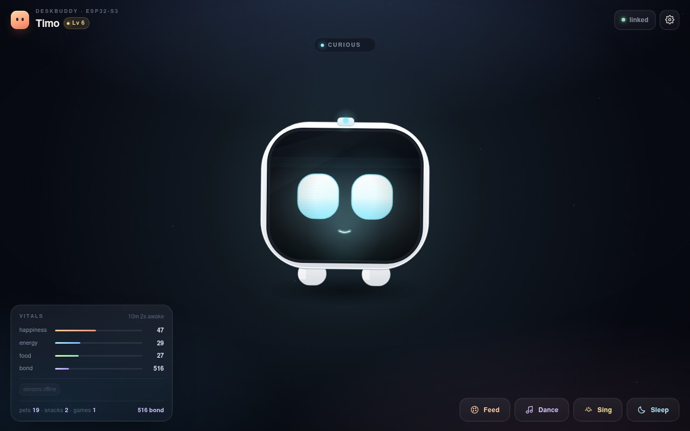
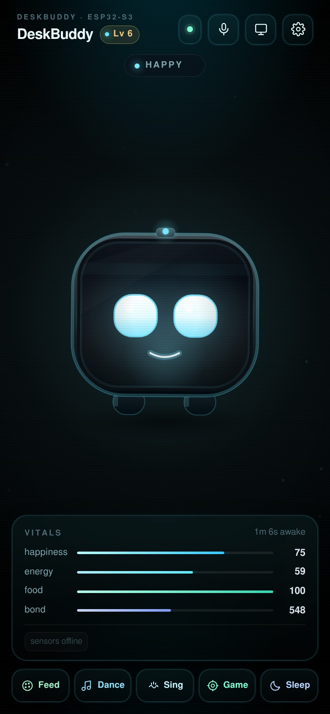

# DeskBuddy

[](https://github.com/priyanshucpc7/desk-buddy/actions/workflows/build.yml)

A desk pet for an **ESP32-S3 with no display and no sensors**.

The board is the brain. Your laptop's browser is the face. An old Android phone —
this one runs 5.1.1 — can be a second face *and* donate its sensors: motion,
light, sound, battery. Everything talks over your WiFi; nothing is in the cloud.



## What it does

- Blinks, breathes, looks around, squints, gets bored, falls asleep.
- Moods driven by needs: **happiness, energy, food, bond** (persisted in NVS).
- Reacts to touch: tap = poke (it gets startled, then annoyed if you spam it),
  drag = pet (hearts, blush, purring).
- Reacts to the phone's senses: shake it → dizzy; cover the light sensor →
  sleepy; a loud room → startled; feeding and playing change its mood.
- Remembers its name, personality and level across reboots.
- Laptop UI is self-contained: **no app, no internet, no external libraries** —
  served straight from the ESP32.
- Android app renders the same buddy full-screen and streams sensor data back.

| Web UI | Android app |
| --- | --- |
|  |  |

## Hardware

| Needed | Notes |
| --- | --- |
| ESP32-S3 dev board | Tested with **16 MB flash / 8 MB PSRAM**, CH343 USB-serial |
| USB cable | for the first flash |
| Laptop | Chrome/Firefox/Safari — anything with WebSocket |
| Old Android phone | optional; Android 5.0+ (tested target: 5.1.1) |

Optional extras (off by default): WS2812 status LED (`GPIO48` on most devkits),
passive buzzer, BOOT button as a pet button (`GPIO0`, enabled by default).

No screen, no OLED, no accelerometer, no light sensor required on the board.

## Install

### 1. Flash the ESP32

Grab `deskbuddy-esp32s3-16mb.bin` from the
[Releases](../../releases) page, then:

```bash
# pip install esptool
esptool --chip esp32s3 -p COM5 -b 921600 write_flash 0x0 deskbuddy-esp32s3-16mb.bin
```

On Linux/macOS the port is usually `/dev/ttyACM0` or `/dev/ttyUSB0`.
You can also flash `DeskBuddy.ino.bin` at `0x10000` alone to update the app
without touching saved settings.

### 2. Give it your WiFi

On first boot the buddy raises its own hotspot (no internet needed for this step):

1. Join **`DeskBuddy-XXXX`** — password `deskbuddy`.
2. Open **<http://192.168.4.1>**.
3. Settings (⚙) → Network → enter your WiFi name/password → **Save & reboot**.
4. Rejoin your normal WiFi and open **<http://deskbuddy.local>**.

Prefer a cable? Serial at `115200`:

```
wifi MyNetwork|my-password
```

The buddy keeps its hotspot available as a fallback while also being on your
WiFi, so `http://192.168.4.1` keeps working if the router changes address.

### 3. (Optional) Make the old phone the face + sensors

Install `app-debug.apk` from Releases (allow "install unknown apps"), open it,
then:

- **Find on WiFi** — finds the ESP32 over mDNS, or
- type `deskbuddy.local` / the IP from step 2 / `192.168.4.1` on the hotspot.

Allow microphone access if you want noise reactions. The app streams:

| Sensor | Used for |
| --- | --- |
| accelerometer | shake → dizzy, jolt detection |
| gyroscope | streamed with motion data |
| light | dark → sleepy, light → wake |
| proximity | reported live in the laptop HUD |
| battery | shown in the HUD |
| microphone | loudness → startled reactions |

Keep the app in the foreground; the screen stays awake by default.

## Using it

- **Click / tap** the buddy: poke.
- **Drag across it**: pet.
- **Feed / Play / Sleep** buttons (or keys `F`, `P`, `S`).
- Settings (⚙) for name, sound, WiFi, reset.
- Mood, stats and sensor HUD update live from the ESP32.

Serial commands (`115200`): `status`, `feed`, `play`, `sleep`, `poke`, `pet`,
`shake`, `noise`, `name <x>`, `reset`, `scan`, `wifi <ssid>|<pass>`, `reboot`.

## How it works

```
   laptop browser ── HTTP + WebSocket :80 ──┐
                                            ├──  ESP32-S3  (brain)
   Android phone  ── JSON over TCP :81 ─────┘     moods · needs · NVS
        └── accelerometer, light, mic, battery ──┘
```

- The firmware is dependency-free C++: a hand-rolled HTTP/1.1 + WebSocket server
  (SHA-1/base64 included), a newline JSON socket, WiFi AP+STA, mDNS, ArduinoOTA.
- The face is a single 52 KB HTML file, gzipped at build time into the firmware
  (`tools/embed_web.py`) and served with `Content-Encoding: gzip`.
- The phone app is plain Java + Canvas, **no AndroidX, no third-party libraries**,
  so it builds in seconds and installs on Android 5.

Protocol details: [docs/PROTOCOL.md](docs/PROTOCOL.md).

## Repository layout

```
firmware/DeskBuddy/   sketch, brain, network stack, generated web_ui.h
web/index.html        the browser face (source of the embedded UI)
android/              Java app (minSdk 21)
tools/                embed_web.py, preview.py, make_icon.py
.github/workflows/    CI: firmware + APK + release assets
```

## Building

Both artifacts are built by GitHub Actions on every push (`.github/workflows/build.yml`);
a `ci-latest` prerelease is refreshed with the firmware and APK, and `v*` tags
create a versioned release. Nothing is compiled on your machine.

Local firmware build, if you want it:

```bash
python3 tools/embed_web.py
arduino-cli core install esp32:esp32@3.3.12
arduino-cli compile \
  --fqbn "esp32:esp32:esp32s3:FlashSize=16M,PSRAM=disabled,PartitionScheme=app3M_fat9M_16MB" \
  firmware/DeskBuddy
```

Local APK build needs JDK 17 + Android SDK 34: `gradle -p android :app:assembleDebug`.

UI development without flashing (fake ESP32 on localhost 8080):

```bash
python3 tools/preview.py
# open http://localhost:8080/?ws=8081  (add &mood=annoyed to preview expressions)
```

## Configuration

`firmware/DeskBuddy/config.h`:

| Define | Default | Meaning |
| --- | --- | --- |
| `DB_AP_PASS` | `deskbuddy` | setup hotspot password (≥8 chars) |
| `DB_BUTTON_PIN` | `0` | BOOT button = pet |
| `DB_USE_LED` / `DB_LED_PIN` | `0` / `48` | WS2812 mood LED (needs Adafruit NeoPixel) |
| `DB_USE_BUZZER` / `DB_BUZZER_PIN` | `0` / `5` | chirps on reactions |
| `DB_OTA` | `1` | ArduinoOTA on port 3232 |

## Troubleshooting

**Can't open `deskbuddy.local`** — mDNS is often blocked on guest/enterprise WiFi
or on Android 5. Use the IP address instead (serial `wifi` prints it; the router
also lists it).

**Saved the wrong WiFi** — the buddy falls back to its hotspot after ~15 s.
Join `DeskBuddy-XXXX`, fix it at `192.168.4.1`, or use serial `wifi ssid|pass`.

**Flashing the full image reset my settings** — the merged image covers the NVS
partition with `0xFF`. That is normal for a first install. For updates, flash
`DeskBuddy.ino.bin` at `0x10000`, or use ArduinoOTA.

**Boot loop after flashing** — wrong flash mode/size. The CI merge uses
`--flash_mode keep` to respect the built bootloader. If your board is 4 MB or 8 MB,
recompile with the matching `FlashSize` and partition scheme for your module.

**Phone can't find the buddy** — make sure both are on the same 2.4 GHz network
(the ESP32 does not do 5 GHz), then type the IP manually.

## License

MIT. Have fun. Pet responsibly.
